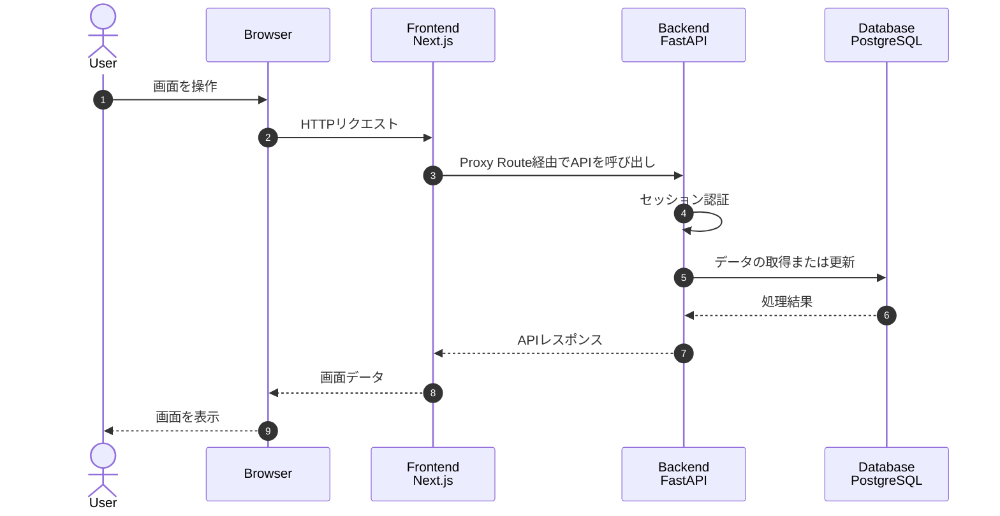

# Todo App

Next.js、FastAPI、PostgreSQL で構築した、認証機能付きの ToDo CRUD アプリケーションです。

フロントエンドとバックエンドを独立したコンテナとして構成し、Docker Compose によるローカル実行に加えて、AWS CodeBuild、Amazon ECR、Amazon ECS を利用したデプロイに対応しています。

## 目次

1. [主な機能](#1-主な機能)
2. [技術構成](#2-技術構成)
3. [システム構成](#3-システム構成)
4. [API 概要](#4-api-概要)
5. [AWS 構成](#5-aws-構成)
6. [環境変数](#6-環境変数)
7. [ローカル環境の構築](#7-ローカル環境の構築)
8. [動作確認](#8-動作確認)
9. [その他](#9-その他)

---

## 1. 主な機能

- ユーザー ID とパスワードによるログイン
- セッション Cookie による認証状態の維持
- ToDo の作成、取得、更新、削除
- ToDo の完了状態の切り替え
- 削除した ToDo のゴミ箱表示
- ゴミ箱内の ToDo の一括削除

---

## 2. 技術構成

- Frontend
  - Next.js: React を基盤としたフルスタック Web アプリケーションフレームワークです。
  - React: コンポーネント単位でユーザーインターフェースを構築するライブラリです。
  - App Router: Next.js におけるファイルベースのルーティング機能です。
  - Axios: HTTP リクエストを扱うためのクライアントライブラリです。
  - Tailwind CSS: ユーティリティクラスを組み合わせてスタイルを定義する CSS フレームワークです。
- Backend
  - FastAPI: Python で高速な Web API を構築するためのフレームワークです。
  - SQLAlchemy: Python からデータベースを操作するための ORM ライブラリです。
  - Pydantic: API の入出力データを検証し、型として管理するライブラリです。
  - Passlib: パスワードのハッシュ化と検証を行うライブラリです。
- Database
  - PostgreSQL: ユーザー情報と ToDo データを永続化するリレーショナルデータベースです。
  - AWS では PostgreSQL 17 を使用します。
  - ローカル Docker Compose では `postgres:16-alpine` イメージを使用します。
- Development
  - Docker: アプリケーションと実行環境をコンテナイメージとして管理します。
  - Docker Compose: Frontend、Backend、Database の各コンテナをまとめて起動・管理します。
- AWS
  - AWS CodeBuild: ソースコードからコンテナイメージを自動的にビルドします。
  - Amazon ECR: ビルドしたコンテナイメージを保管するプライベートレジストリです。
  - Amazon ECS: コンテナ化した Frontend と Backend をサービスとして実行・管理します。

---

## 3. システム構成

フロントエンドとバックエンドは、それぞれ独立した Dockerfile、buildspec、ECS サービスを持つ構成です。

ブラウザからバックエンド API を直接呼び出さず、Next.js の Proxy Route を経由して通信します。バックエンドの接続先は環境変数から実行時に組み立てるため、ローカル環境と AWS 環境で同じアプリケーションコードを使用できます。



- Frontend
  - Next.js アプリケーションを実行します。
  - ブラウザからのリクエストを受け付けます。
  - Proxy Route を通じて Backend を呼び出します。
- Backend
  - FastAPI アプリケーションを実行します。
  - 認証処理と ToDo の CRUD 処理を提供します。
  - PostgreSQL に接続します。
- Database
  - ユーザー情報と ToDo データを管理します。

フロントエンドとバックエンドを分離することで、ビルド、デプロイ、スケーリング、障害調査をサービス単位で実施できます。

ポート構成は次のとおりです。

- AWS 本番環境などで Frontend と Backend のコンテナイメージをそれぞれ個別に実行する場合
  - Frontend: `8080`
  - Backend: `8081`
- ローカル検証環境で Docker Compose から起動する場合
  - Frontend: `localhost:3000` からコンテナの `8080` へ転送
  - Backend: `localhost:8000` からコンテナの `8081` へ転送

---

## 4. API 概要

API の詳細なリクエスト形式とレスポンス形式は、アプリケーション起動後に Swagger UI から確認できます。

- Swagger UI: `http://localhost:8000/docs`

認証 API は次のとおりです。

- `POST /api/auth/login`
  - ユーザー ID とパスワードを使用してログインします。
- `POST /api/auth/logout`
  - ログアウトし、認証セッションを終了します。
- `GET /api/auth/me`
  - 現在ログインしているユーザーの情報を取得します。

ToDo API は次のとおりです。

- `GET /api/todos`
  - ログインユーザーの ToDo 一覧を取得します。
- `POST /api/todos`
  - 新しい ToDo を作成します。
- `PATCH /api/todos/{todo_id}`
  - 指定した ToDo の内容または状態を更新します。
  - 通常一覧では、ToDo をゴミ箱へ移動する際にもこの API を使用します。
- `DELETE /api/todos/{todo_id}`
  - 指定した ToDo を完全に削除します。
  - ゴミ箱画面からの個別削除で使用します。
- `DELETE /api/todos/trash/all`
  - ゴミ箱内の ToDo を一括削除します。

---

## 5. AWS 構成

AWS 環境では、Frontend と Backend を別々の ECS サービスとしてデプロイします。


この構成では、インターネットからのアクセスを ALB で受け付け、フロントエンドとバックエンドをそれぞれ ECS Fargate 上で稼働させます。バックエンドは Aurora PostgreSQL に接続し、ECR からコンテナイメージを取得します。機密情報は Secrets Manager から注入し、ログとメトリクスは CloudWatch へ送信します。

- Frontend ECS Service
  - Next.js アプリケーションを実行します。
  - Proxy Route を通じて Backend ECS Service を呼び出します。
- Backend ECS Service
  - FastAPI アプリケーションを実行します。
  - PostgreSQL に接続します。

Frontend は、次の環境変数から Backend の接続先を実行時に組み立てます。

```env
BACKEND_SCHEMA=http://
BACKEND_FQDN=backend-app.portfolio.local
BACKEND_PORT=8081
```

本番環境では、`BACKEND_FQDN` と `BACKEND_PORT` の設定が必須です。未設定の場合、Frontend コンテナが起動しても Proxy Route から Backend API への接続に失敗します。

Frontend と Backend が別の ECS タスクで稼働する場合、Backend の接続先に `localhost` や `127.0.0.1` は指定できません。これらは Frontend コンテナ自身を指すため、次のような仕組みで解決可能なホスト名を指定します。

- Amazon ECS Service Connect
- AWS Cloud Map
- 内部 Application Load Balancer
- プライベート DNS

Health Check エンドポイントは次のとおりです。

- Frontend: `/healthcheck`
- Backend: `/health`
- Backend: `/healthcheck`

CodeBuild では、Frontend と Backend で個別の buildspec を使用します。

- Frontend: `frontend/buildspec.yml`
- Backend: `backend/buildspec.yml`

CodeBuild プロジェクトには、少なくとも次の環境変数を設定します。

- `AWS_ACCOUNT_ID`
  - Amazon ECR を所有する AWS アカウント ID
- `AWS_REGION`
  - Amazon ECR リポジトリが存在する AWS リージョン
- `APP_NAME`
  - プッシュ先の Amazon ECR リポジトリ名
  - Frontend と Backend で異なるリポジトリ名を指定します。
- `IMAGE_TAG`
  - コンテナイメージに付与するタグ
  - 未指定の場合は、`CODEBUILD_RESOLVED_SOURCE_VERSION` の先頭7文字を使用します。
- `CONTAINER_NAME`
  - ECS デプロイ用のイメージ定義ファイルに設定するコンテナ名
  - 変更する場合は、各 buildspec 内の既定値も更新します。

---

## 6. 環境変数

ローカル環境では、`.env` の値を Docker Compose 経由で各コンテナへ渡します。

AWS 環境では、AWS Secrets Manager、AWS Systems Manager Parameter Store、ECS タスク定義などからコンテナ環境変数へ注入することを想定しています。アプリケーションは値の取得元に依存せず、実行時に設定された環境変数のみを参照します。

Frontend で使用する主な環境変数は次のとおりです。

- `FRONTEND_PORT`
  - Frontend コンテナの待受ポート
- `BACKEND_SCHEMA`
  - Backend 接続先のスキーマ
  - 既定値は `http://`
- `BACKEND_FQDN`
  - Backend のホスト名
- `BACKEND_PORT`
  - Backend の待受ポート

Backend で使用する主な環境変数は次のとおりです。

- `CORS_ORIGINS`
  - Backend が許可するオリジン
  - 複数指定する場合はカンマ区切りで記述します。
- `SESSION_SECRET`
  - セッション Cookie の署名に使用する秘密鍵
- `SESSION_COOKIE_NAME`
  - セッション Cookie の名前
- `DISABLE_SECURE_COOKIES`
  - `true` の場合、Cookie の `Secure` 属性を無効にします。
  - HTTP 接続を使用するローカル環境向けの設定です。
- `LOG_SQL`
  - `true` の場合、SQL ログを出力します。

データベース接続に使用する環境変数は次のとおりです。

- `DB_HOST`
  - PostgreSQL のホスト名
- `DB_PORT`
  - PostgreSQL のポート
- `DB_USERNAME`
  - PostgreSQL の接続ユーザー名
- `DB_PASSWORD`
  - PostgreSQL の接続パスワード
- `DB_NAME`
  - 接続先のデータベース名

PostgreSQL コンテナの初期化に使用する環境変数は次のとおりです。

- `POSTGRES_DB`
  - 初期化時に作成するデータベース名
- `POSTGRES_USER`
  - 初期化時に作成するユーザー名
- `POSTGRES_PASSWORD`
  - 初期化時に設定するパスワード

デモユーザーに使用する環境変数は次のとおりです。

- `DEMO_USER_ID`
  - デモユーザーのログイン ID
- `DEMO_USER_NAME`
  - デモユーザーの表示名
- `DEMO_USER_PASSWORD`
  - デモユーザーのログインパスワード

アプリケーション起動時に対象のデモユーザーが存在しない場合は、自動的に作成されます。

---

## 7. ローカル環境の構築

ローカル環境には、次のソフトウェアが必要です。

- Git
- Docker
- Docker Compose

`.env.example` を `.env` にコピーします。

```bash
cp .env.example .env
```

作成した `.env` を開き、データベース接続情報、セッション Cookie、デモユーザー、ポート、Backend 接続先などを設定します。

設定後、リポジトリのルートディレクトリで次のコマンドを実行します。

```bash
bash scripts/reset-local.sh
```

このスクリプトでは、次の処理を順番に実行します。

1. Docker Compose 環境の停止
2. Docker ボリュームの削除
3. Frontend、Backend、Database の再ビルド
4. 各コンテナの起動
5. データベースユーザーへの権限付与
6. テーブルの作成
7. サンプルデータの登録

データベースには、次の SQL ファイルが適用されます。

1. `sql/user_registration.sql`
2. `sql/create_table.sql`
3. `sql/sample_insert.sql`

> `scripts/reset-local.sh` は Docker ボリュームを削除するため、既存のローカルデータも初期化されます。

---

## 8. 動作確認

アプリケーション起動後、次の URL にアクセスします。

- ログイン画面: `http://localhost:3000/login`
- Frontend Health Check: `http://localhost:3000/healthcheck`
- Backend Health Check: `http://localhost:8000/health`
- Backend Health Check: `http://localhost:8000/healthcheck`
- Swagger UI: `http://localhost:8000/docs`

ログインには、`.env` に設定した次の値を使用します。

- ユーザー ID: `DEMO_USER_ID`
- パスワード: `DEMO_USER_PASSWORD`

基本的な確認手順は次のとおりです。

1. `bash scripts/reset-local.sh` を実行します。
2. `http://localhost:3000/login` を開きます。
3. デモユーザーでログインします。
4. ToDo を新規作成します。
5. ToDo の完了状態を切り替えます。
6. ToDo を削除します。
7. ゴミ箱画面に削除した ToDo が表示されることを確認します。
8. ゴミ箱内の ToDo を一括削除します。
9. 必要に応じて Health Check と Swagger UI を確認します。

---

## 9. その他

- 認証処理
  - 認証に関する依存関係は `backend/app/dependencies/auth.py` に集約しています。
  - 認証処理を各 API から分離し、将来的にセッション認証から JWT 認証などへ変更しやすい構成としています。
- API クライアント
  - Frontend の Axios 設定は `frontend/lib/api-client.ts` に集約しています。
  - Backend との接続設定や共通処理を一元管理し、各画面やコンポーネントへの通信処理の分散を防いでいます。
- 設定管理
  - アプリケーションは環境変数のみを参照します。
  - ローカル環境では `.env`、AWS 環境では Secrets Manager や ECS タスク定義など、実行環境に応じて設定の管理方法を変更できます。
- サービス分離
  - Frontend と Backend の Dockerfile、buildspec、ECS サービスを個別に管理しています。
  - ビルド、デプロイ、スケーリング、障害調査をサービス単位で実施できます。
